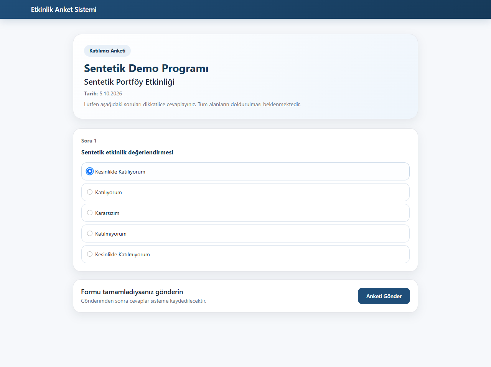
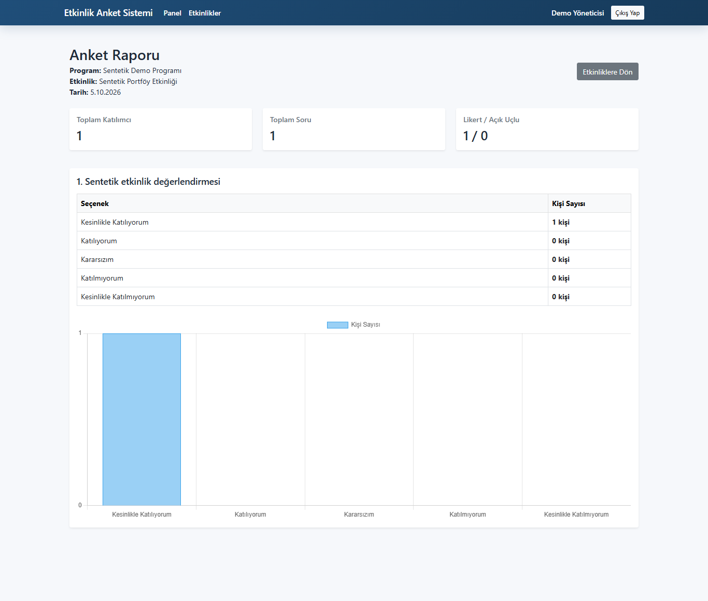

# Etkinlik Anket Sistemi

ASP.NET Core MVC ile etkinlik anketleri oluşturma, anonim cevap toplama ve sonuçları raporlama projesi.

- Yönetici oturumu; etkinlik ve soru ekleme, düzenleme ve silme.
- Likert ve açık uçlu sorular; katılımcı sayısı, cevap tabloları ve grafikler.
- C# / .NET 8, ASP.NET Core MVC, Entity Framework Core + SQL Server 8.0.24, Bootstrap ve Chart.js 4.5.1.

## Yerel kurulum

.NET 8 SDK (veya .NET 8 hedefini destekleyen SDK) ve SQL Server / Windows SQL LocalDB gerekir. Ayrı, boş bir demo veritabanı kullanın; gerçek kurum veritabanına bağlanmayın.

PowerShell:

```powershell
$env:ConnectionStrings__DefaultConnection = 'Server=(localdb)\MSSQLLocalDB;Database=EtkinlikAnketDemo;Trusted_Connection=True;TrustServerCertificate=True;'
$env:DEMO_ADMIN_EMAIL = 'admin@example.invalid'
$demoPassword = Read-Host 'En az 12 karakterlik yeni demo parolası' -AsSecureString
$env:DEMO_ADMIN_PASSWORD = [System.Net.NetworkCredential]::new('', $demoPassword).Password
dotnet restore
dotnet build
dotnet run --no-launch-profile --urls http://localhost:5080
```

İlk açılışta yalnızca yapılandırdığınız veritabanı için EnsureCreated çalışır ve ortam değişkenleriyle verilen yönetici oluşturulur. Parola PasswordHasher ile özetlenir. Kaynakta sabit giriş parolası bulunmaz. Yapılandırma yoksa uygulama açıklayıcı hata verir. Mevcut düz metin parola içeren yönetici kayıtları bu temiz sürüme aktarılmamalıdır. Migration dosyaları şema referansıdır; ilk kurulum EnsureCreated kullanır. Mevcut veritabanını yükseltme senaryosu doğrulanmadı.

http://localhost:5080/Account/Login üzerinden giriş yapın; etkinlik oluşturun, soruları ekleyin ve katılımcı anket bağlantısını açın. Formlar antiforgery kontrolü kullanır; çıkış POST ile yapılır. Gerekli tablolar ve yönetici dışında demo içerik otomatik yüklenmez.

## Doğrulama ve sınırlar

2026-10-05: .NET derlemesi 0 hata / 0 uyarı. Ayrı SQL LocalDB örneğinde sentetik yöneticiyle giriş, yetkisiz yönetici yönlendirmesi, CSRF reddi, etkinlik ve Likert sorusu oluşturma, cevap gönderme ve grafik raporu Edge ile doğrulandı. Gerçek kullanıcı veya kurum verisi kullanılmadı; dış ağ istekleri engellendi. Kayıt ekranı yoktur; tek yönetici ilk açılışta yapılandırılır. Bağımsız otomatik test paketi bulunmuyor.

Tekrarlanan anonim cevapları engelleme, giriş hız sınırlama, çok kullanıcılı yetkilendirme ve üretim dağıtımı bu incelemede doğrulanmadı. Açık uçlu cevaplara kişisel bilgi yazılabilir; gerçek cevaplar depoya eklenmemelidir. Bu bir portföy / yerel demo projesidir.

## Ekran görüntüleri

Görseller yalnız sentetik etkinlik, soru ve cevaplardan yeniden üretildi.




## Üçüncü taraf bileşenler

Bootstrap, jQuery, jQuery Validation ve Chart.js lisansları wwwroot/lib altında korunmuştur. Projeye yeni bir kaynak kod lisansı eklenmedi.
